# Escaping switch-case hell: rendering 20+ dynamic widgets in Angular

This guide compares four ways to render a dashboard whose widgets are chosen at runtime by a `type`
field. It also compares two ways to pass inputs to those widgets. Everything here is backed by the
runnable demo in this repo. The numbers come from `npm run measure`, and the type-safety claims come
from deliberately breaking the code and recording what the compiler or the tests said.

The demo has **20 real widget types** (40 widgets on screen), roughly the size of a large production dashboard.

**TL;DR**:
- **At 20 types, `@switch` is the most expensive approach for every change you make:**
  - The template is 204 lines and grows ~13 lines per widget; the registry template is 20 lines and
    never grows.
  - Adding an input that every widget receives (like `printView`) means **20 edits** in the
    `@switch`, one per `@case`, vs **3** in the renderer.
  - Every new widget edits the same two shared files, so parallel widget PRs conflict.
- **Use a registry + renderer directive with reflection-based bindings** (Approach B + Pattern 2,
  the pattern from the real-world refactor described in §1).
- **`@switch` is still fine** for small, stable sets (under ~8 types).
- **Add these to B + Pattern 2:**
  - A typed `widget` key in the registry.
  - A coverage spec.
- **If full compile-time type safety is the priority, use the typed widget map** (Approach D). It
  catches every binding mistake we tried at build time, including ones `@switch` misses. The cost:
  ~12 lines per widget instead of 2, and an explicit edit in each affected entry when inputs change.
- **Avoid `ngComponentOutlet`** for widgets that emit events.

> **Diagrams** in this guide are [Mermaid](https://mermaid.js.org). They render on GitHub, GitLab and
> in VS Code (Markdown preview). The numbers in the charts are the ones from `npm run measure`.

---

## 1. The problem

The original `dashboard-render.component.html` of a production app rendered 13 widget types like this:

```html
@switch (widget?.type) {
  @case ('STATS') {
    <app-stats-widget
      [widget]="widget"
      [printView]="printView()"
      [readOnly]="readOnly()"
      [editMode]="editMode()"
      [canResizeGridItems]="canResizeGridItems()"
      (contextMenu)="onWidgetContextMenu($event)"
    />
  }
  @case ('IMAGE') { … same 8 lines, plus timescales/variables … }
  … 11 more …
  @default { <mat-card class="error-card">…Unsupported Widget…</mat-card> }
}
```

**Each new widget costs:**
- A ~10-line `@case` block.
- An `import` statement and an `imports: []` entry in the render component.

**Each new shared input** (say `printView`) costs a line in *every* case.

**Two developers adding two widgets** edit the same block, so they get merge conflicts.

**The refactor replaced it with:**
- A type → component map (`widget-component-map.ts`, +43 lines).
- A renderer directive (`dashboard-widget-renderer.directive.ts`, +124 lines).
- The template went from 170 lines to 26, and the component lost 28 lines of widget imports.

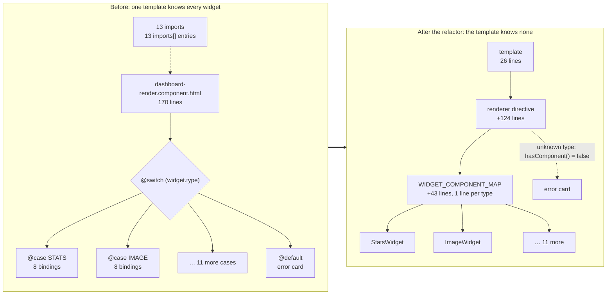

## 2. The demo

```bash
npm install
npm start            # http://localhost:4200
npm test             # 85 specs: every approach renders the same dashboard and behaves the same
npm run measure      # builds with --stats-json and prints the tables in §4
```

There are **20 widget types**. Like in the production app, their inputs deliberately differ: every widget takes
`widget`, `editMode`, `density`, `loading` and `locale` (5 inputs), but only 7 take `timescale` and only 5 emit `widgetEvent`.

| # | Widget | `timescale` | `widgetEvent` output |
|--:|---|:-:|:-:|
| 1 | [Stats card](src/app/widgets/stats-card/stats-card-widget.component.ts) |  |  |
| 2 | [Chart (time series)](src/app/widgets/chart/chart-widget.component.ts) | ✓ |  |
| 3 | [Table](src/app/widgets/table/table-widget.component.ts) |  | ✓ |
| 4 | [Timeline](src/app/widgets/timeline/timeline-widget.component.ts) | ✓ | ✓ |
| 5 | [Gauge](src/app/widgets/gauge/gauge-widget.component.ts) |  |  |
| 6 | [Heatmap (load profile)](src/app/widgets/heatmap/heatmap-widget.component.ts) | ✓ |  |
| 7 | [Scatter (correlation)](src/app/widgets/scatter/scatter-widget.component.ts) |  |  |
| 8 | [Load duration curve](src/app/widgets/duration-curve/duration-curve-widget.component.ts) | ✓ |  |
| 9 | [Category bar](src/app/widgets/category-bar/category-bar-widget.component.ts) |  |  |
| 10 | [Donut](src/app/widgets/donut/donut-widget.component.ts) |  |  |
| 11 | [KPI + sparkline](src/app/widgets/kpi-sparkline/kpi-sparkline-widget.component.ts) | ✓ |  |
| 12 | [Text / notes](src/app/widgets/text/text-widget.component.ts) |  |  |
| 13 | [Image / schematic](src/app/widgets/image/image-widget.component.ts) |  |  |
| 14 | [Alarm list](src/app/widgets/alarm-list/alarm-list-widget.component.ts) |  | ✓ |
| 15 | [Target progress](src/app/widgets/target-progress/target-progress-widget.component.ts) |  |  |
| 16 | [Asset status grid](src/app/widgets/status-grid/status-grid-widget.component.ts) |  | ✓ |
| 17 | [Weather](src/app/widgets/weather/weather-widget.component.ts) |  |  |
| 18 | [Period comparison](src/app/widgets/period-comparison/period-comparison-widget.component.ts) | ✓ |  |
| 19 | [Setpoint (editable)](src/app/widgets/setpoint/setpoint-widget.component.ts) |  | ✓ |
| 20 | [Forecast](src/app/widgets/forecast/forecast-widget.component.ts) | ✓ |  |

Every route renders the same 40 widgets (each type twice) plus one `HEATMAP_3D` widget, which this
build doesn't know. That simulates a dashboard saved by a newer backend, and it should show the
fallback card.

| Route | Approach | Entry point |
|---|---|---|
| `/a-switch` | A · `@switch` | [switch-dashboard.component.html](src/app/approaches/a-switch/switch-dashboard.component.html) |
| `/b-strict` | B · Pattern 1 | [widget-renderer-strict.directive.ts](src/app/approaches/b-registry/widget-renderer-strict.directive.ts) |
| `/b-flexible` | B · Pattern 2 | [widget-renderer.directive.ts](src/app/approaches/b-registry/widget-renderer.directive.ts) |
| `/b-lazy` | B · Pattern 2, lazy registry | [widget-renderer-lazy.directive.ts](src/app/approaches/b-registry/widget-renderer-lazy.directive.ts) |
| `/c-outlet` | C · `ngComponentOutlet` | [outlet-dashboard.component.ts](src/app/approaches/c-outlet/outlet-dashboard.component.ts) |
| `/d-typed-map` | D · Typed widget map | [widget-definitions.ts](src/app/approaches/d-typed-map/widget-definitions.ts) |

The [shared spec](src/app/approaches/approaches.spec.ts) checks the following for every approach:
- **Rendering:** 40 widgets plus 1 fallback card.
- **Updates in place:** toggling edit mode updates widgets without re-creating them (DOM node
  identity is kept).
- **Wiring:** timescale and table-row events reach the widgets. The strict pattern is expected *not*
  to wire them; see §5.
- **Console:** no `console.error` output, so dev-mode NG0303 binding warnings fail the test.

---

## 3. The four approaches

How each approach turns `widget.type` into a component. The bold boxes are the files you edit when
you add a widget:

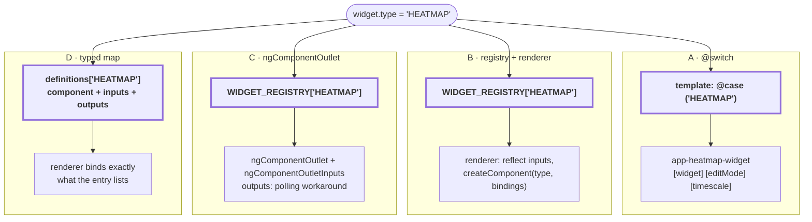

### A · `@switch` / `@case` (baseline)

[switch-dashboard.component.html](src/app/approaches/a-switch/switch-dashboard.component.html):
one `@case` per type, with every binding written out by hand.

**Strengths:**
- It's plain Angular, with nothing to learn.
- It has the best compile-time checking of all the approaches:
  - `@switch` narrows `widget` to the exact config type inside each case, so mapping a gauge into the
    stats case is a `TS2322` error.
  - Binding an input a widget doesn't have is `NG8002`.
  - A misspelled case label is `TS2678`.

**Weaknesses at scale:**
- **Template size:** 204 lines for 20 types, plus 20 imports and 20 `imports: []` entries in the
  component. Each further type adds ~13 lines, because every case carries 5–6 bindings (the
  production app's carry 6–8; its template was already 170 lines at 13 types).
- **Missing cases are silent:** a type with no `@case` compiles fine and quietly lands in
  `@default`. `@default never;` would catch it, but you can't have both an exhaustive check and a
  runtime fallback card for unknown types.
- **Every widget change touches one hot file**, which causes merge conflicts.
- **New shared inputs** have to be added to every case.

### B · Registry + renderer directive + `createComponent()`

**The registry** ([widget-registry.ts](src/app/registry/widget-registry.ts)):

```ts
export const WIDGET_REGISTRY = {
  STATS: StatsCardWidgetComponent,
  CHART: ChartWidgetComponent,
  TABLE: TableWidgetComponent,
  // … 17 more, one line each …
  FORECAST: ForecastWidgetComponent,
} satisfies Record<WidgetType, Type<unknown>>;   // missing key → compile error
```

**The directive** ([widget-renderer.directive.ts](src/app/approaches/b-registry/widget-renderer.directive.ts))
resolves the component for `widget.type` and creates it:

```ts
this.viewContainer.createComponent(componentType, { bindings });
```

It uses Angular's `inputBinding(name, signal)` and `outputBinding(name, fn)`. Because the bindings
are signals, input changes flow straight into the child without any diffing, and the child is
re-created **only when the type changes**. That's the `currentType` check, and the spec verifies it.

**The template** shrinks to one line per concern:

```html
@for (widget of state.widgets(); track widget.id) {
  <ng-container
    [appWidgetRenderer]="widget"
    #renderer="appWidgetRenderer"
    [editMode]="state.editMode()"
    [timescale]="state.timescale()"
    (widgetEvent)="state.log($event)"
  />
  @if (!renderer.hasComponent()) {
    <app-unsupported-widget [type]="$any(widget).type" />
  }
}
```

What the renderer does over a widget's lifetime:

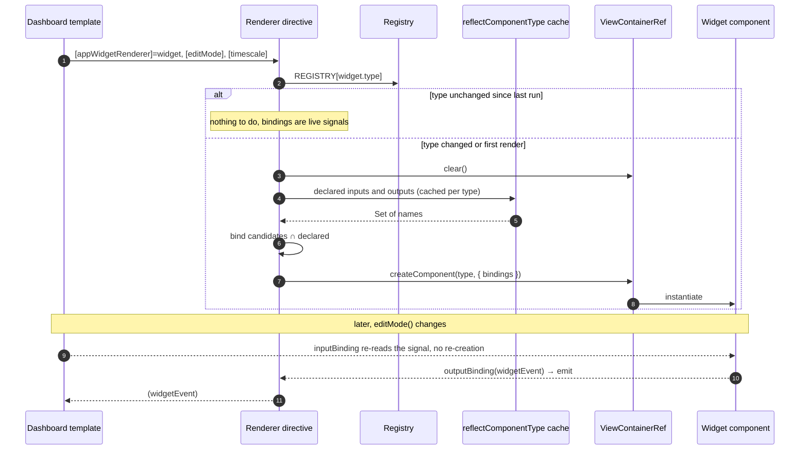

**Lazy variant**:
- [widget-loaders.ts](src/app/registry/widget-loaders.ts) maps each type to a
  `() => import('./…')` loader, and
  [widget-renderer-lazy.directive.ts](src/app/approaches/b-registry/widget-renderer-lazy.directive.ts)
  awaits the loader before calling `createComponent`.
- Widget code then downloads only for the types that are actually on screen.
- The loader map must live in **its own file**. If it sits next to the eager map, the eager imports
  pull every widget into the bundle anyway. That happened during this demo's development.

### C · `*ngComponentOutlet`

[outlet-dashboard.component.ts](src/app/approaches/c-outlet/outlet-dashboard.component.ts) is built
in, so you write no directive for inputs. The built-in `NgComponentOutlet` (checked against
`@angular/common` 22.2.3) has these limits:

| Limitation | Consequence |
|---|---|
| Accepts only `ngComponentOutlet`, `Inputs`, `Injector`, `EnvironmentInjector`, `Content`, `NgModule`. **There's no `bindings` and no outputs.** | Widget events need a workaround. [outlet-outputs.directive.ts](src/app/approaches/c-outlet/outlet-outputs.directive.ts) polls `componentInstance` after every render and subscribes by hand. The alternative is to inject a callback token into every widget. |
| Inputs are a plain object applied with `componentRef.setInput()` in `ngDoCheck`, on every change-detection pass. | Fine for performance, since unchanged values are skipped by `Object.is`. But you need a new object whenever any value changes, so you build one inputs object per widget in a `computed`. |
| `setInput()` on an input the component doesn't declare logs **NG0303** to `console.error` in dev mode. | You still need the same reflection filter as Pattern 2. Without it, the demo logged 26 NG0303 errors on load (one per widget without `timescale`). |
| No `hasComponent()` signal. | You resolve the type yourself, then add an `@if/@else` around the outlet. |

C is a good fit when widgets have inputs only and you want zero custom infrastructure. Once widgets
emit events, you rebuild half of Approach B, in a less direct way.

### D · Typed widget map (full type safety)

A TypeScript map, created for one dashboard instance, where every widget type names its component
**and spells out every input and output that component has**. The compiler derives the required
keys and value types from the component class itself.

[widget-definitions.ts](src/app/approaches/d-typed-map/widget-definitions.ts):

```ts
export function createWidgetDefinitions(dashboard: DashboardState) {
  return defineWidgets({
    STATS: {
      component: StatsCardWidgetComponent,
      inputs: { widget: (widget) => widget, editMode: () => dashboard.editMode() },
      outputs: {},
    },
    TABLE: {
      component: TableWidgetComponent,
      inputs: { widget: (widget) => widget, editMode: () => dashboard.editMode() },
      outputs: { widgetEvent: (event) => dashboard.log(event) },
    },
    HEATMAP: {
      component: HeatmapWidgetComponent,
      inputs: {
        widget: (widget) => widget, // `widget` is typed HeatmapWidget here
        editMode: () => dashboard.editMode(),
        timescale: () => dashboard.timescale(),
      },
      outputs: {},
    },
    // … 17 more …
  });
}
```

**How the types work** ([widget-definition.ts](src/app/approaches/d-typed-map/widget-definition.ts)):
- `InputGetters<C, W>` maps every public `input()` of component `C` to a getter
  `(widget: W) => <the input's accepted type>`.
- `OutputHandlers<C>` maps every public `output()` to `(event: <the output's event type>) => void`.
- `defineWidgets()` exists only for inference. Its parameter is a mapped type over the map's keys,
  so TypeScript infers each entry's component, then checks `inputs` and `outputs` against it.
  `NoInfer` stops the bindings from influencing that inference.
- Getters are functions, not values, so they stay reactive: the renderer wraps each one as
  `inputBinding(name, () => get(widget()))`, which tracks the widget signal and any dashboard
  signals the getter reads.

How the compiler turns a component class into a checklist:

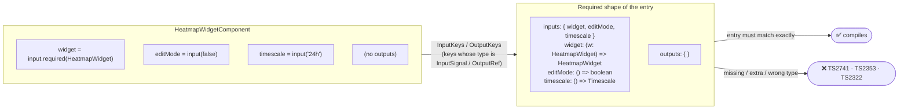

**The renderer** ([typed-widget-renderer.directive.ts](src/app/approaches/d-typed-map/typed-widget-renderer.directive.ts))
needs no reflection and no candidate list. It looks up the entry by `widget.type` and binds exactly
what the entry lists. There's one deliberate cast: TypeScript can't link `definitions[widget.type]`
to `widget` across a union. The cast is safe because the entry was chosen by that same type.

**The template** passes only the widget and the map. `editMode`, `timescale` and event handling are
wired in TypeScript:

```html
<ng-container [appTypedWidgetRenderer]="widget" #renderer="appTypedWidgetRenderer" [definitions]="definitions" />
```

**What the compiler enforces.** Each row below was tested on the real 20-entry map:

| Mistake | Compiler error |
|---|---|
| Widget type missing from the map | `Property 'FORECAST' is missing in type …` |
| Wrong component for a type (GAUGE → stats card) | `TS2322: Type 'GaugeWidget' is not assignable to type 'StatsWidget'` |
| An input left out (CHART without `timescale`) | `TS2741: Property 'timescale' is missing … required in type 'InputGetters<ChartWidgetComponent, ChartWidget>'` |
| An input the component doesn't have (STATS with `timescale`) | `TS2353: 'timescale' does not exist in type 'InputGetters<StatsCardWidgetComponent, StatsWidget>'` |
| Wrong value type (`timescale: () => dashboard.editMode()`) | `TS2322: Type 'boolean' is not assignable to type 'Timescale'` |
| An output left out (TABLE without `widgetEvent`) | `TS2741: Property 'widgetEvent' is missing … in type 'OutputHandlers<TableWidgetComponent>'` |
| Output handler with the wrong event type | `TS2322: … 'WidgetEvent' is not assignable to type 'string'` |

**What the types can't see:**
- An aliased input (`input(…, { alias: 'range' })`) or a legacy `@Input()` decorator. The types work
  on property names, but Angular binds by public name.
- We tested an alias: `tsc` passed, and the runtime spec
  [widget-definitions.spec.ts](src/app/approaches/d-typed-map/widget-definitions.spec.ts) failed. It
  compares each entry's keys with the inputs and outputs Angular reflects for the component.
- Keep that spec, or ban aliases on widget inputs.

**Cost:**
- **Boilerplate:** every entry lists all of its bindings, about 12 lines per widget. That's close to
  a `@case`, but in TypeScript and fully checked.
- **Shared inputs need N edits:** adding a shared input to 20 widgets means adding it to 20 entries.
  The compiler lists every entry that still lacks it, so you can't miss one, but you do write them
  all.

---

## 4. Side-by-side comparison

### The cost of a change (the core argument)

Total lines matter less than **how much you touch, and where, every time something changes**.
Counted on the 20-type demo:

| Change | A · `@switch` | B · registry + Pattern 2 | D · typed map |
|---|---|---|---|
| Add widget type #21 | ~13-line `@case` + import + `imports[]` entry, in 2 shared files | 1 registry line + 1 import, in 1 file | ~12-line entry + 1 import, in 1 file; the compiler lists every binding you must provide |
| Give every widget a new shared input (e.g. `readOnly`) | **20 bindings**, one per `@case`; nothing tells you if you miss one | **3 lines**: directive `input()`, candidate entry, one host binding | **20 getters**, one per entry; the compiler names every entry still missing it |
| Give 7 widgets an optional input (e.g. `timescale`) | 7 bindings, and you must find the right cases | Same 3 lines; widgets opt in by declaring the input | 7 getters; the compiler points to exactly those 7 entries |
| Template a reviewer has to read | 204 lines, +13 per type | 20 lines, constant | 15 lines, constant |
| Two developers add two widgets in parallel | Both edit the same `@switch` and `imports[]`, so they conflict | Two different lines in the map; at most a trivial conflict | Two separate entry blocks in one file; rarely a real conflict |

**Where you edit when you add widget #21** (red = shared files that every widget PR touches, so
parallel PRs conflict there):

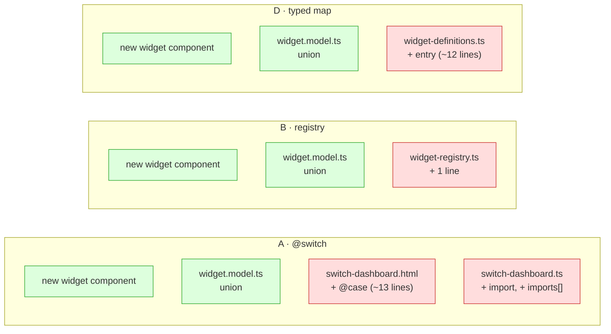

The `@switch` cost per change grows with the number of widget types and nothing checks that you
covered every case. B keeps the cost constant but relies on a spec. D keeps the per-widget cost of
`@switch`, but the compiler checks every change.

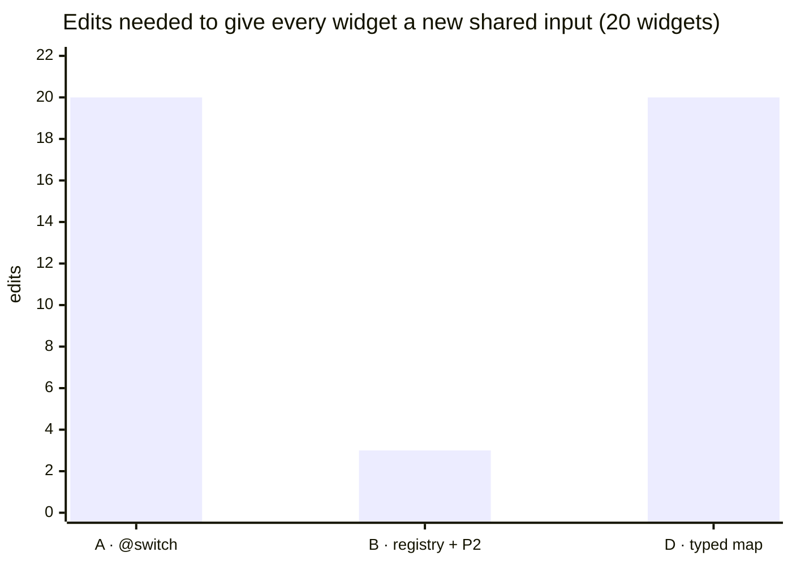

### Measured footprint (`npm run measure`)

Counts are non-blank, non-comment lines in each approach's own files, measured at today's 20 types.
The widgets, shell and model are shared and excluded. "+lines per new widget" is what a developer
adds for one more type; the 5- and 40-type columns project from it.

| Approach | Template | Component | Registry + renderer | **Total @ 20 types** | +lines per new widget | @ 5 types (projected) | @ 40 types (projected) |
|---|--:|--:|--:|--:|--:|--:|--:|
| A · `@switch` | 204 | 57 | 0 | **261** | 12.6 | 72 | 513 |
| B · strict (P1) | 18 | 66 | 57 | **141** | 2.0 | 111 | 181 |
| B · flexible (P2) | 20 | 86 | 69 | **175** | 2.0 | 145 | 215 |
| B · lazy (P2) | 20 | 75 | 80 | **175** | 2.8 | 134 | 230 |
| C · `ngComponentOutlet` | 16 | 83 | 69 | **168** | 2.0 | 138 | 208 |
| D · typed map | 15 | 65 | 281 | **361** | 12.3 | 176 | 608 |

**Reading the totals honestly:**
- At 20 types, B-flexible is already well below `@switch` (175 vs 261), and the gap widens by
  ~10 lines per widget (513 vs 215 at 40).
- Every widget now takes 5–6 inputs, so each `@case` binds 5–7 properties, close to the production
  app's 6–8. That is why `@switch` grew from 174 to 261 lines, while the registry approaches barely moved.
- **D is the largest** (361 lines, +12.3 per widget), because every binding is written out per
  widget, as in `@switch`. That's what buys its type safety: those lines are type-checked TypeScript
  instead of template bindings that are optional and unchecked for completeness.
- **Real-world check:** the production app at 13 types went from a 170-line template to 26 lines plus 167 lines
  of map and directive. That's roughly even on day one; from then on each widget costs +2 lines
  instead of +10.

Total lines against the number of widget types (A, B-flexible and D; the lines are projected from
the measured 20-type totals and per-widget costs, and the 5-type points match the table):

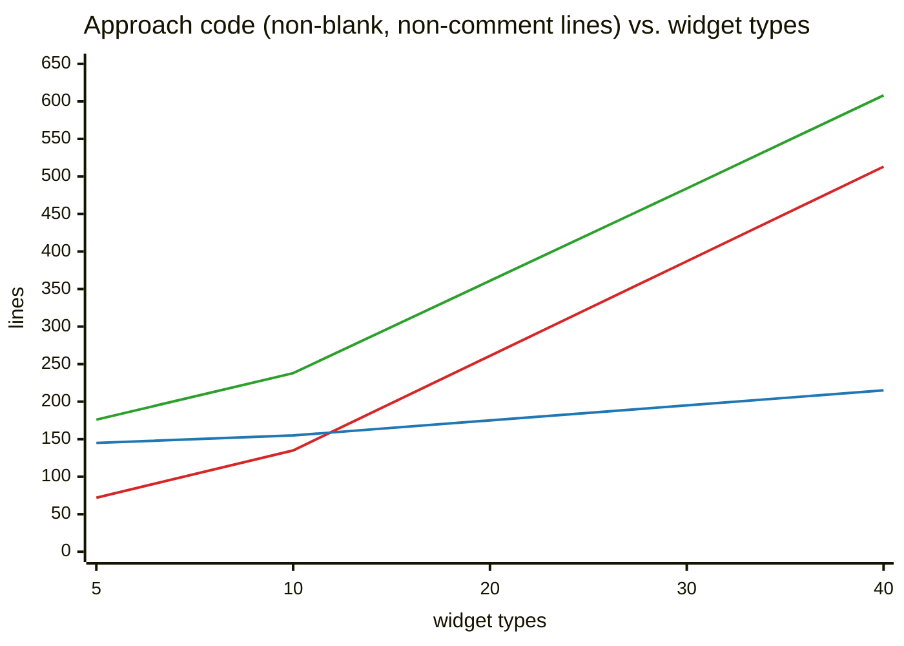

Lines: 🔴 **A · `@switch`** (513 at 40 types), 🔵 **B · flexible** (215), 🟢 **D · typed map** (608). At 5 types
the order is reversed for A: it is the smallest (72 lines), and it overtakes B-flexible at about
**12 types**. D stays above both because every binding is written out in checked TypeScript.

### Measured bundle cost (production build, gzip -9)

These are the bytes a route pulls in on top of the shared 260 kB `main` chunk.

| Approach | Eager route chunks | …of which widget code | Widget code loaded on demand |
|---|--:|--:|--:|
| A · `@switch` | 52.54 kB (24.34 kB gz) | 35.74 kB | — |
| B · strict (P1) | 48.45 kB (24.47 kB gz) | 35.74 kB | — |
| B · flexible (P2) | 49.07 kB (24.77 kB gz) | 35.74 kB | — |
| B · lazy (P2) | **12.92 kB (5.36 kB gz)** | **0 kB** | 38.04 kB |
| C · `ngComponentOutlet` | 48.98 kB (24.71 kB gz) | 35.74 kB | — |
| D · typed map | 50.68 kB (24.30 kB gz) | 35.74 kB | — |

What the bundle numbers show:
- **A, B-eager, C and D all import every widget statically.** Each needs the component class
  (`imports: []` for A, the map for B and C), so the bundles are within ~0.5 kB gz of each other.
  **Bundle size is not a reason to choose between A, B, C and D.**
- **The lazy registry is the only change that moves the needle:** 5 kB gz instead of 24 kB gz up
  front, about a 4.5× cut, with widget code fetched only for the types on screen. The saving grows
  with widget size; ECharts-based widgets would save far more than these SVG ones.
  - `@defer` inside each `@case` can do the same for Approach A, but that's one more block per case.
  - D can go lazy too, by making `component` a `() => import(…)` loader. You'd then have to state the
    component type explicitly, since there's no class to infer it from.
  - Lazy loading has a cost: the first render of each type waits on a network round-trip.

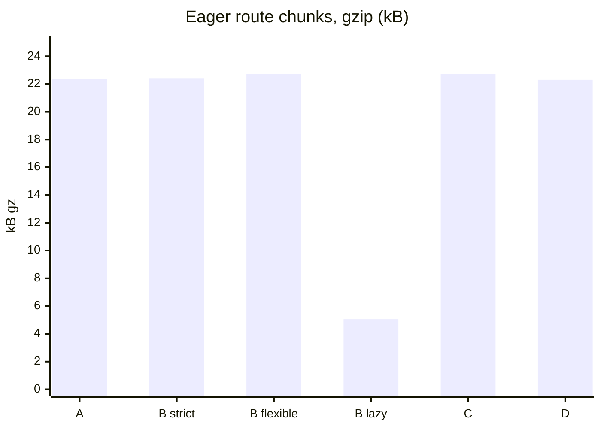

### Type safety: what each approach catches

The demo code was deliberately broken in each way below. The table records what happened.

| Mistake | A · `@switch` | B · strict (P1) | B · flexible (P2) | C · outlet | D · typed map |
|---|---|---|---|---|---|
| Typo in type key or case label | ❌ compile (TS2678) | ❌ compile | ❌ compile (`satisfies`) | ❌ compile (shares registry) | ❌ compile |
| New type added to the union but not rendered | ⚠️ silent → `@default` | ❌ compile | ❌ compile | ❌ compile | ❌ compile |
| Wrong component for a type (GAUGE → stats card) | ❌ compile (narrowing, TS2322) | ❌ compile | ⚠️ **runtime only** (fixable, §7) | ⚠️ runtime only | ❌ compile (TS2322) |
| Host binds an input the widget lacks | ❌ compile (NG8002) | n/a (contract) | ✅ skipped by design | ⚠️ NG0303 unless filtered | ❌ compile (TS2353) |
| Host forgets an input the widget has | ⚠️ silent unless the input is `required` | ⚠️ silent for non-contract inputs | ⚠️ silent if not a candidate (coverage spec) | ⚠️ silent | ❌ compile (TS2741) |
| Host forgets an output the widget has | ⚠️ silent | ⚠️ silent | ⚠️ silent if not a candidate (coverage spec) | ⚠️ silent | ❌ compile (TS2741) |
| Widget renames an input (`timescale` → `timeScale`) | ❌ compile (NG8002) | ❌ compile if it's a contract input | ⚠️ silent at compile time, **caught by the coverage spec** | ⚠️ silent, caught by the coverage spec | ❌ compile (TS2741 + TS2353) |
| Wrong value type for an input | ❌ compile | ❌ compile (contract inputs) | ⚠️ none: getters are `() => unknown` | ⚠️ none: `Record<string, unknown>` | ❌ compile (TS2322) |
| Aliased or `@Input()`-decorator input | ❌ compile | ⚠️ runtime | ⚠️ runtime (coverage spec) | ⚠️ runtime | ⚠️ runtime, **caught by the definitions spec** |

❌ = caught at build time · ⚠️ = not caught at build time · ✅ = intended behaviour

When each approach tells you about a mistake (cheapest feedback first):

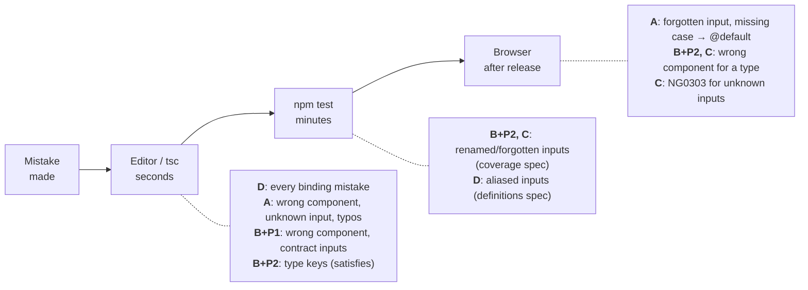

### Summary scorecard

**"Time to add a widget"** counts the places you edit *outside the new widget's own file and the
model union*, which every approach needs:

| | A · `@switch` | B + P1 strict | **B + P2 flexible** | B + P2 lazy | C · outlet | **D · typed map** |
|---|---|---|---|---|---|---|
| **Code footprint** @ 20 types | 261 lines (+12.6/type) | 141 (+2) | 175 (+2) | 175 (+2.8) | 168 (+2) | 361 (+12.3) |
| **Time to add a widget** | 3 edits in 2 files (import, `imports[]`, ~13-line `@case`) | 1 registry line + implement the full contract | **1 registry line** | 1 loader line | 1 registry line, plus workaround code if it has a new output | 1 entry (~12 lines) in 1 file; the compiler lists what's required |
| **Time to add a *new* input name** | 1 binding in each case that needs it | Contract + **every** widget + directive | Directive input + candidate entry + 1 host binding (all widgets get it) | Same as P2 | Add to the inputs record | 1 getter in each entry that needs it (compiler-enforced) |
| **Type safety** | ★★★★☆ | ★★★★☆ | ★★★☆☆ (★★★★ with §7) | ★★★☆☆ | ★★☆☆☆ | **★★★★★** |
| **Bundle impact** | All widgets eager | All eager | All eager | **On demand** | All eager | All eager (lazy possible) |
| **Maintainability** (rubric below) | 2 / 5 at 20+ types (4 at ≤5) | 3 / 5 | **4.5 / 5** | 4 / 5 | 2.5 / 5 | **4 / 5** |

**Maintainability rubric.** Average of four 1–5 scores. Re-score it if your weights differ:

| | Change locality | Merge-conflict surface | Mistakes caught automatically | Onboarding / readability |
|---|:-:|:-:|:-:|:-:|
| A (20+ types) | 1 (every change hits one hot template) | 1 | 4 (misses forgotten inputs and missing cases) | 2 (a 204-line switch, and growing) |
| B + P1 | 3 (new inputs ripple through every widget) | 4 | 4 | 4 |
| B + P2 | 5 | 5 | 4 (with coverage spec) | 4 |
| B + P2 lazy | 5 | 5 | 4 | 3 (async creation, chunk timing) |
| C | 4 | 4 | 2 | 1 (outputs workaround, polling) |
| D | 4 (one file; shared-input changes touch each entry) | 4 | 5 | 3 (advanced mapped/conditional types) |

---

## 5. Input binding strategies

### Pattern 1 · Strict: a shared `WidgetComponentContract`

[widget-contract.ts](src/app/widgets/widget-contract.ts) and
[widget-renderer-strict.directive.ts](src/app/approaches/b-registry/widget-renderer-strict.directive.ts).

```ts
export interface WidgetComponentContract<W extends Widget = Widget> {
  readonly widget: Signal<W>;
  readonly editMode: Signal<boolean>;
}

export const STRICT_WIDGET_REGISTRY: {
  readonly [K in WidgetType]: Type<WidgetComponentContract<WidgetOf<K>>>;
} = WIDGET_REGISTRY;
```

The renderer binds the contract's inputs unconditionally and needs no reflection. A
`satisfies Record<keyof WidgetComponentContract, …>` keeps the binding list in step with the
contract.

**Pros:**
- Strongest checking of the dynamic approaches: each component must accept *its own* config type.
- Simplest renderer.
- Fewest lines.

**Cons:**
- **The contract is the lowest common denominator.** `timescale` (7 of 20 widgets) and
  `widgetEvent` (5 of 20) aren't in it, so on `/b-strict` the time-based widgets ignore the
  timescale picker, and clicks on tables, alarms, asset tiles and setpoints never reach the event
  log. The spec asserts this on purpose.
- **Wiring them up means growing the contract**, and then *every* widget must declare `timescale`
  and `widgetEvent`, even though 13 and 15 of the 20 never use them.
  - In the production app, the contract already lists `printView`, `readOnly` and `canResizeGridItems`
    for all 13 widgets, while `timescales`/`variables` are only used by 3.
- Contract inputs are still bound as `() => unknown` getters inside `inputBinding`. The *registry*
  is type-checked; the binding call isn't.

**Use it when** widgets really are uniform: same inputs, same outputs, differing only in rendering.

### Pattern 2 · Flexible: reflection-based binding 

The flexible renderer offers a fixed set of **candidate** inputs and outputs:
- **Discovery:** for each widget component, it reads the inputs/outputs the component declares
  with `reflectComponentType()`, cached per type.
- **Binding:** it binds only the intersection.

```ts
const candidates: Record<(typeof CANDIDATE_INPUTS)[number], () => unknown> = {
  widget: this.widget,
  editMode: this.editMode,
  timescale: this.timescale,
};
const bindings = Object.entries(candidates)
  .filter(([name]) => declaredInputNames(componentType).has(name))
  .map(([name, getter]) => inputBinding(name, getter));
if (declaredOutputNames(componentType).has('widgetEvent')) {
  bindings.push(outputBinding('widgetEvent', (e) => this.widgetEvent.emit(e)));
}
```

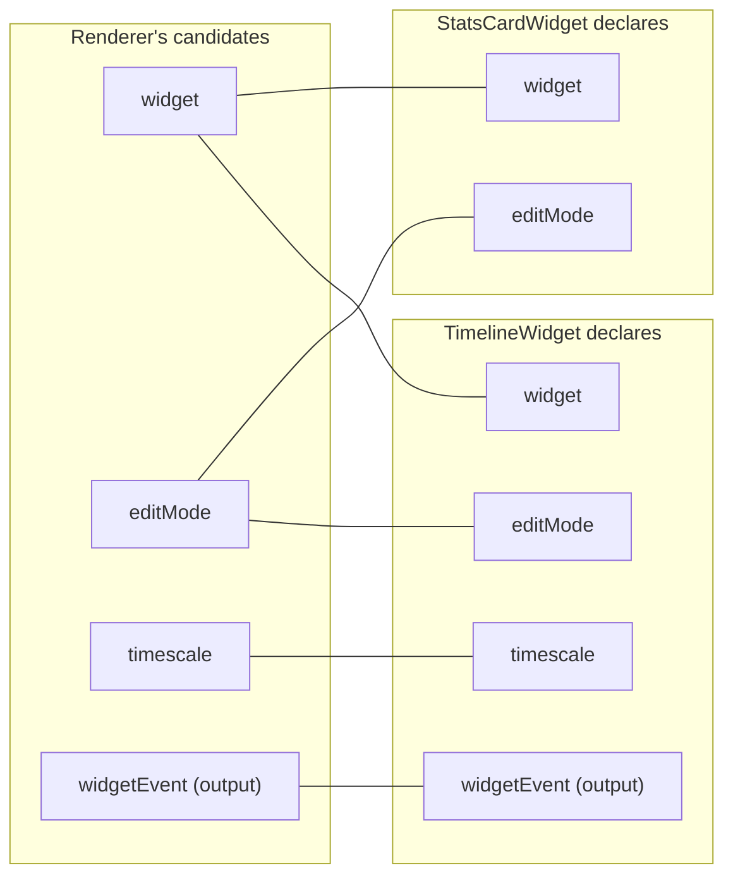

Only the connected pairs are bound. `timescale` is simply never offered to the stats card, so there
is no NG0303 and no dead input on it.

**Pros:**
- Widgets declare only what they use, and adding a widget never forces changes elsewhere.
- New optional inputs cost one candidate entry and reach every widget that opts in.
- Reflection runs once per component type, not once per render.

**Cons:**
- **Name agreement is checked only at runtime.** If a widget declares `timeScale`, it compiles, it
  renders, and it never updates. The demo confirmed this: the build succeeded and 3 behaviour specs
  failed.
- No compile-time link between a type key and its component's config type (GAUGE → stats card
  compiles).
- Values pass through `() => unknown`, so input value types aren't checked.

**Close the gaps cheaply:**
1. **Coverage spec**: [widget-registry.spec.ts](src/app/registry/widget-registry.spec.ts) asserts
   that every input and output each registered component declares is in `CANDIDATE_INPUTS` /
   `CANDIDATE_OUTPUTS`. It turns the silent `timeScale` drop into a failing test (verified).
2. **Typed candidate map**: `Record<(typeof CANDIDATE_INPUTS)[number], …>` instead of
   `Record<string, …>` makes a typo on the *renderer* side a compile error (TS2561, verified).
3. **Typed `widget` key in the registry** (§7): this brings the component ↔ config check back.

---

## 6. Recommendation

### The short version

Both B + Pattern 2 and D beat `@switch` at this size. Which one fits depends on what you
optimise for:

| If you optimise for… | Choose | Because |
|---|---|---|
| **Compile-time guarantees** | **D · typed map** | Every binding is type-checked, and forgetting an input or output is a compile error, which not even `@switch` gives you. |
| **Least code per change** | **B + Pattern 2** | 2 lines per widget, and 3 lines to give every widget a new input. Pair it with the typed `widget` key and the coverage spec (§7). |

D costs ~10 more lines per widget than B and needs one runtime spec, for aliases. B needs two
guards (spec and typed key) and still can't check input value types.

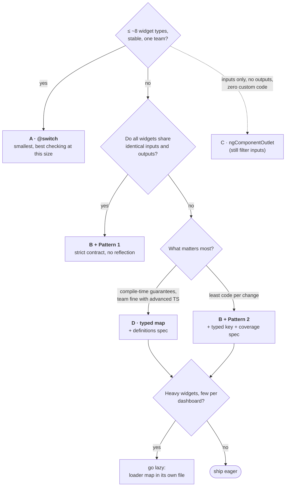

### Why B + Pattern 2 fits a growing dashboard

- **Scale:** The production app has 13+ widget types and is growing. At 20 types `@switch` is already the
  largest option, and the change costs in §4 (20 edits for a shared input, two hot files per new
  widget) grow with every type.
- **Inputs really do differ:** `timescales`/`variables` are bound on only 3 of 13 widgets (Image,
  Text, Categorical v2). Pattern 1 would force those dead inputs onto the other 10 or drop the
  feature.
- **Locality:** a new widget is one map line, with no shared-template edits and no merge conflicts.
- **Runtime behaviour matches `@switch`:**
  - Inputs flow as signals.
  - Components are re-created only on type change.
  - Unknown types fall back cleanly via `hasComponent()`.
- **Its weak spots are fixable** with a typed registry key and a coverage spec (§7). After that, the
  only thing it checks less strictly than `@switch` is input value types.

### When to choose something else

| Situation | Choose |
|---|---|
| ≤ ~8 widget types, stable, one team | **A · `@switch`**. It's the smallest at that size and has the best type safety. Add `@defer` to heavy cases if needed. |
| Widgets share the exact same inputs/outputs | **B + Pattern 1**: the strongest checking with no reflection. |
| Heavy widgets (charts, maps, editors), or many types where few appear per dashboard | **B + Pattern 2 with a lazy registry**. It's the only option that cuts route bundle size. |
| Inputs only, no outputs, and you want zero custom code | **C · `ngComponentOutlet`**. Still filter inputs by reflection to avoid NG0303. |
| You want the compiler to own the widget wiring, and the team is comfortable with advanced TS types | **D · typed map**. Keep the definitions spec for aliased inputs. |
| Widgets emit events | Not C. |

### Migrating from `@switch` gradually

No big-bang rewrite is needed. The renderer slots into the existing `@default`:

```html
@switch (widget?.type) {
  @case ('STATS') { <app-stats-widget … /> }        <!-- not migrated yet -->
  @case ('TABLE') { <app-table-widget … /> }        <!-- not migrated yet -->
  @default {
    <ng-container [appWidgetRenderer]="widget" #r="appWidgetRenderer"
                  [printView]="printView()" … (contextMenu)="onWidgetContextMenu($event)" />
    @if (!r.hasComponent()) { <mat-card class="error-card">…Unsupported…</mat-card> }
  }
}
```

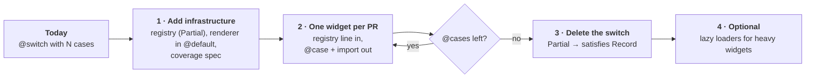

Every arrow is a releasable state.

1. **Add the infrastructure.** Create the registry (empty to start; type it `Partial<Record<…>>`
   while migrating), the renderer directive and the coverage spec. Put the renderer in `@default`.
   Behaviour is unchanged, because unknown types still show the error card via `hasComponent()`.
2. **Migrate one widget per PR.** Add it to the registry, delete its `@case` and remove it from
   `imports: []`. The coverage spec flags any input or output the renderer doesn't supply yet; add
   it as a candidate.
3. **Delete the switch** once only `@default` is left, and inline the renderer. Tighten the registry
   type from `Partial<Record<…>>` to `satisfies Record<WidgetType, …>` so missing types become
   compile errors.
4. **Optional:** switch heavy widgets to lazy loaders.

Each step is releasable on its own and easy to review. Note that a component created with
`inputBinding` can't also be driven with `setInput()` (NG0317). Don't mix the two on one instance
during the migration.

**Migrating to D instead** follows the same steps, with `TypedWidgetRendererDirective` in
`@default`. `defineWidgets()` demands every widget type, so while migrating, loosen its constraint
to `M extends Partial<Record<WidgetType, unknown>>` and return the partial map. This variant isn't in
the demo. Restore the full `Record` in step 3, so a
missing type becomes a compile error again. Each migrated `@case` turns into a map entry almost line
for line: `[editMode]="editMode()"` becomes `editMode: () => dashboard.editMode()`.

### Checklist: adding widget #21 (B + Pattern 2)

1. Add the config type to the `Widget` union in the model.
2. Create the component and declare only the inputs and outputs it needs, using names from
   `CANDIDATE_INPUTS` / `CANDIDATE_OUTPUTS`.
3. Add one line to `WIDGET_REGISTRY`, or `WIDGET_LOADERS` if lazy.
4. Run `npm test`. The coverage spec fails if the widget uses an input name the renderer doesn't
   supply.
5. **New input name?** Add it to the directive (`input()` + candidate entry) and bind it once in the
   host template. Every widget that declares it now receives it.

### Checklist: adding widget #21 (D · typed map)

1. Add the config type to the `Widget` union in the model.
2. Create the component, with signal `input()`/`output()` and no aliases.
3. Add an entry to `createWidgetDefinitions`: `component`, then let the compiler errors tell you
   which `inputs` and `outputs` are still missing.
4. Run `npm test`. The definitions spec catches anything the types can't see.

---

## 7. Possible refinements to the flexible renderer

The demo's Pattern 2 directive is modelled on the production refactor. Comparing it with the alternatives
surfaced these follow-ups, roughly in order of value.

1. **Type the `widget` key per type.** The production map is typed as
   `Record<Widget['type'], Type<WidgetComponentContract>>`.
   - This checks that the 5 shared inputs exist on every component, but `widget: Signal<Widget>` is
     the whole union. Mapping `GAUGE_CHART` to the stats widget therefore still compiles.
   - It also mixes the patterns: the map carries a Pattern 1 contract, while the directive binds
     `timescales`/`variables` by Pattern 2 reflection, and the contract doesn't mention them.
   A mapped type checks each component against its own config:
   ```ts
   export const WIDGET_COMPONENT_MAP: {
     readonly [K in Widget['type']]: Type<{ readonly widget: Signal<Extract<Widget, { type: K }>> }>;
   } = { … };
   ```
   - Each component must accept its own config, so mapping GAUGE to the table widget is a TS2322
     error (verified here).
   - Nothing else is required of it.
2. **Add the coverage spec** from [widget-registry.spec.ts](src/app/registry/widget-registry.spec.ts).
   It's the only guard against a widget renaming an input that the reflection filter would silently
   drop.
3. **Type the candidate map** as `Record<CandidateInput, () => unknown>` instead of
   `Record<string, () => unknown>`. A renderer-side typo becomes a compile error, and the spec gets
   the list to check against.
4. **Merge the two reflection caches** into one `Map<Type, { inputs; outputs }>`. It's smaller and
   calls `reflectComponentType` once instead of twice per type. Cosmetic.
5. **`afterRenderEffect` vs `effect`:**
   - `afterRenderEffect` runs after the host has rendered, so widgets are created in a follow-up
     pass.
   - A plain `effect` runs during change detection, before rendering.
   - Both work in this demo: the eager directives use `afterRenderEffect` and the lazy one uses
     `effect`. Neither was profiled. Keep the existing choice unless a measurement on a real dashboard
     says otherwise.
6. **Lazy loaders for heavy widgets.** It's an opt-in per entry, and a mixed map works if the
   directive accepts `Type | () => Promise<Type>`.

---

### Appendix: how the numbers were produced

- **Footprint and bundle:** [scripts/measure.mjs](scripts/measure.mjs).
  - Lines are non-blank and non-comment, with inline `template:` blocks counted as template.
  - Bundle numbers walk the esbuild metafile (`browser-stats.json`) from each route's entry chunk
    through static imports (eager) and dynamic imports (on demand), excluding `main`.
- **Type-safety table:** each row was produced by editing the code, running `ng build` /
  `ng test` and recording the error, then reverting.
- **Environment:** Angular 22.2.3, TypeScript 6.0 (strict by default), Vitest 5 via
  `@angular/build:unit-test`, zoneless.
